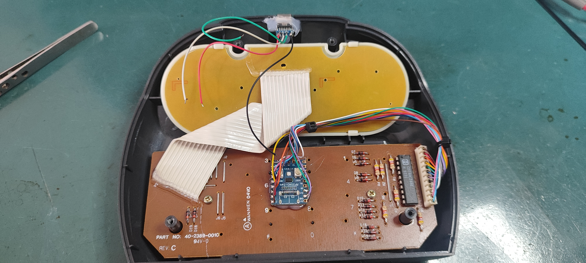
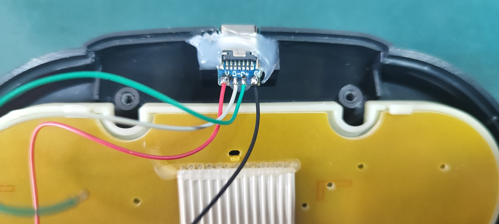

# Atari Jaguar Controller → USB (RP2040)

**A USB adapter for the Atari Jaguar controller, built on the RP2040-Zero.**
Full D-pad, A/B/C, Option, Pause and the 12-key numeric keypad, recognized as a standard USB gamepad.

**English** · [Português](README.pt-BR.md)

<!-- Replace with a photo of the finished adapter -->

---

## Table of contents

- [Features](#features)
- [What you need](#what-you-need)
- [Wiring](#wiring)
- [Installation (flashing the firmware)](#installation-flashing-the-firmware)
- [Using it on Windows](#using-it-on-windows)
- [Button mapping](#button-mapping)
- [Building from source](#building-from-source)
- [Credits and license](#credits-and-license)
- [Support the project](#support-the-project)
- [Disclaimer](#disclaimer)

## Features

- Standard **USB HID gamepad**: no drivers needed.
- **All 21 inputs** of the Jaguar controller: D-pad (2 axes), A, B, C, Option, Pause and the 12 keypad keys (17 buttons).
- Native full-speed USB (TinyUSB) on the RP2040, with 1 ms USB polling.
- Firmware flashed by drag and drop (UF2), no programmer required.
- Prebuilt firmware available in [Releases](../../releases), or build it yourself with GitHub Actions in a few minutes.

## What you need

- 1× **RP2040-Zero** (or a compatible RP2040 board with enough free GPIOs)
- 1× Atari Jaguar controller and a way to reach its **DB15 connector** (a DB15 plug or a sacrificial extension cable)
- Hookup wire, and a soldering iron if you are not using a breakout

## Wiring

> ⚠️ **Power the controller from 3V3, never from 5 V.** RP2040 pins are **not** 5 V tolerant.

| Jaguar DB15 pin | Function | RP2040-Zero |
|:---:|---|:---:|
| 1 | Column 0 | GP0 |
| 2 | Column 1 | GP1 |
| 3 | Column 2 | GP2 |
| 4 | Column 3 | GP3 |
| 10 | Row 0 | GP4 |
| 6 | Row 1 | GP5 |
| 13 | Row 2 | GP6 |
| 12 | Row 3 | GP7 |
| 11 | Row 4 | GP8 |
| 14 | Row 5 | GP9 |
| 7 | VCC | **3V3** |
| 9 | GND | GND |

The pin assignments live in the `COL_PINS` and `ROW_PINS` tables at the top of `main.c`, so they are easy to change.

<!-- Add your own installation photos below. Keep the file names or edit the paths. -->

  
  

  
  

## Installation (flashing the firmware)

1. Download **`jaguar_usb_rp2040.uf2`** from the [latest release](../../releases/latest) (Rev 1.0).
2. Hold the **BOOT** button on the RP2040-Zero, plug it into your PC with USB, then release the button.
3. A drive named **RPI-RP2** appears. Copy the `.uf2` file onto it.
4. The board reboots by itself and shows up as a gamepad. Done.

To update the firmware later, repeat the same steps with the newer `.uf2`.

## Using it on Windows

1. Press <kbd>Win</kbd> + <kbd>R</kbd>, type `joy.cpl` and press Enter.
2. Select **Atari Jaguar Controller** and click **Properties**.
3. Press buttons on the controller and check that the matching buttons light up and the axes move.

<!-- Replace with a screenshot of the Windows game controller properties window -->

  

## Button mapping

| HID button / axis | Jaguar input |
|:---:|---|
| X axis | D-pad left / right |
| Y axis | D-pad up / down |
| Button 1 | A |
| Button 2 | B |
| Button 3 | C |
| Button 4 | Option |
| Button 5 | Pause |
| Buttons 6 to 14 | Keypad 1 to 9 |
| Button 15 | Keypad \* |
| Button 16 | Keypad 0 |
| Button 17 | Keypad # |

**Tuning:** if a key reads unreliably (for example with a long cable), increase `SETTLE_US` in `main.c`. The USB VID/PID in `usb_descriptors.c` are TinyUSB test values; change them if you distribute the adapter.

## Credits and license

This project is a **port** of the excellent
[**jaguar_usb**](https://github.com/raphnet/jaguar_usb) firmware by
**Raphaël Assénat ([raphnet](https://www.raphnet.net))**, originally written for
AVR microcontrollers (ATmega8 / ATmega168) with the V-USB stack.
The controller matrix scanning logic and the HID report layout come from his work.
Full credit goes to the original author.

**What changed in this port**

- The software USB stack (V-USB) and all AVR-specific code were removed.
- USB is now handled by [TinyUSB](https://github.com/hathach/tinyusb) on the RP2040's native USB controller.
- Targets the RP2040-Zero, built with the [Raspberry Pi Pico SDK](https://github.com/raspberrypi/pico-sdk).

**License**

This project is distributed under the **GNU General Public License, version 2 or (at your option) any later version** (GPL-2.0-or-later), the same terms as the original. See [LICENSE](LICENSE). If you redistribute or modify it, you must keep the original copyright notices and license your changes under the same terms.

| Component | License |
|---|---|
| Original jaguar_usb firmware (Raphaël Assénat) | GPL-2.0-or-later |
| This RP2040 port | GPL-2.0-or-later |
| Raspberry Pi Pico SDK (build-time dependency) | BSD-3-Clause |
| TinyUSB (build-time dependency) | MIT |

If you like this kind of work, please also consider supporting the original author at [raphnet.net](https://www.raphnet.net).

## Support the project

This adapter is free and open source. If it was useful to you and you would like to help fund future retro-gaming hardware projects, donations are very welcome and entirely optional. They do not entitle you to support or special features.

<!-- Edit the links below with your own pages, and delete the ones you do not use. -->
- ☕ **Ko-fi:** https://ko-fi.com/YOUR_NAME
- 🇧🇷 **Pix:** `dev.freitas@gmail.com`

Starring the repository and sharing photos of your build also helps a lot.

## Disclaimer

This is a hobby project provided **as is, without warranty of any kind**. You are responsible for your own wiring and for any damage to your equipment. *Atari* and *Jaguar* are trademarks of their respective owners. This project is not affiliated with or endorsed by Atari or raphnet.
